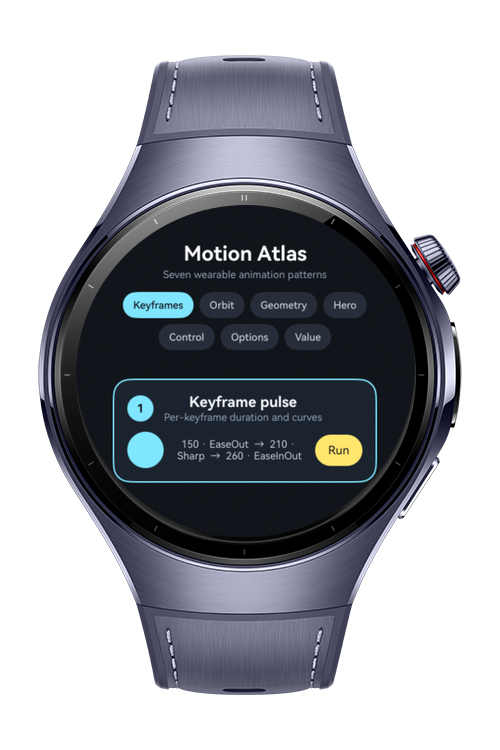
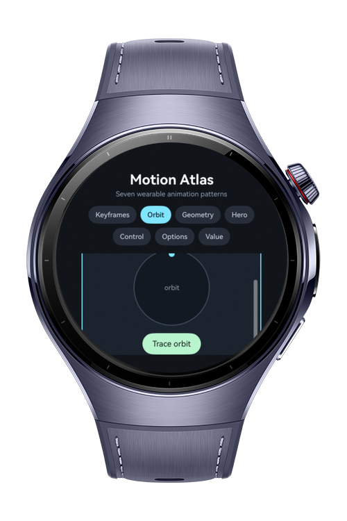
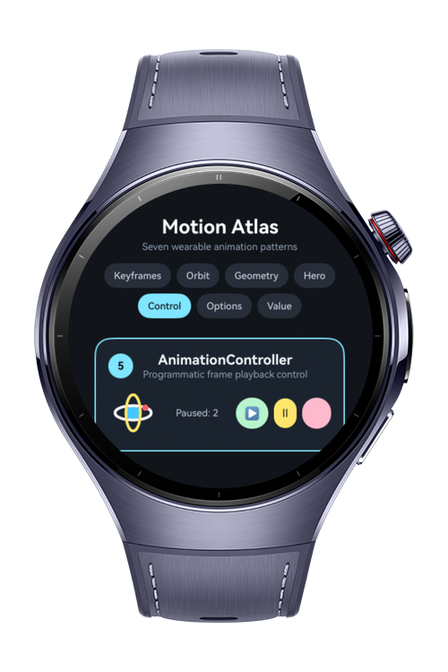
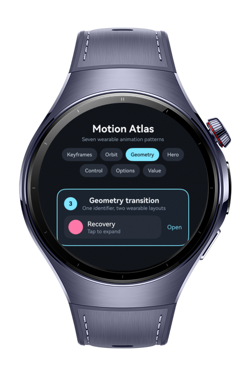

> **Note:** To access all shared projects, get information about environment setup, and view other guides, please visit [Explore-In-HMOS-Wearable Index](https://github.com/Explore-In-HMOS-Wearable/hmos-index).

# How to Build Animation Toolkit

This app is a wearable animation reference library that uses Keyframe Animate To for defining multi-keyframe animations with per-keyframe timing curves, `motionPath` for animating a component along an SVG circular trajectory, `geometryTransition` for seamless layout changes, and shared Transition for hero animations during navigation. It also demonstrates `AnimationController` for programmatic drawable playback control, `AnimationOptions` for animated drawable frame playback, and `SimpleAnimatorOptions` for lightweight value animation. The codelab demonstrates seven animation patterns optimized for round wearable screens.

# Preview

<div>
  
  
  
  
</div>

# Use Cases

- Define three visual states with `keyframeAnimateTo`, each using an independent duration and timing curve.
- Move a clock marker around a circular SVG trajectory with `motionPath`, `translate`, and `animateTo`.
- Morph a recovery card between compact and detailed layouts with `geometryTransition`.
- Expand a small recovery ring into a detail-page hero with `sharedTransition`.
- Start, pause, and stop a frame-based drawable animation using `AnimationController`.
- Configure an `AnimatedDrawableDescriptor` using `AnimationOptions` duration, iterations, per-frame durations, and auto-play.
- Drive a breathing size and opacity effect with a 0-to-1 `SimpleAnimatorOptions` value.

# Technology
## Stack

- **Languages**: ArkTS, ArkUI
- **Frameworks**: HarmonyOS SDK 6.0.1(21)
- **Tools**: DevEco Studio 6.0.1, Hvigor
- **Libraries**:
    - `@kit.ArkUI`
    - `@kit.AbilityKit`
    - `@ohos.arkui.drawableDescriptor`
    - `@ohos.multimedia.image`

## Animation Modules

- `keyframeAnimateTo`: Runs a pulse through three named visual states with `EaseOut`, `Sharp`, and `EaseInOut` curves.
- `motionPath`: Pairs a `translate` state change inside `animateTo` with a closed SVG path that uses `start` and `end` path placeholders. The state change is required; `motionPath` alone does not move the component.
- `geometryTransition`: Applies a stable transition identifier to the recovery card while its size, padding, and content change.
- `sharedTransition`: Gives matching source and detail-page hero elements the same identifier and a shared transition configuration.
- `AnimationController`: Obtains the controller only after the matching `Image` is mounted, and stops it before that image leaves the component tree.
- `AnimationOptions`: Creates an `AnimatedDrawableDescriptor` with `duration`, `iterations`, `frameDurations`, and `autoPlay`.
- `SimpleAnimatorOptions`: Creates a small 0-to-1 animator and uses its frame callback to update the breathing indicator.

# Directory Structure

```text
entry/src/main/ets/
├─ entryability
|   ├─ EntryAbility.ets
├─ model
|   ├─ AnimationDescriptorFactory.ets
├─ pages
    ├─ Index.ets

entry/src/main/resources/
├─ base
|   ├─ element
|   ├─ media
|   ├─ profile
```

# Constraints and Restrictions

## Supported Device

* Huawei Watch 5
* DevEco Studio wearable simulator

# License

**How to Build Animation Toolkit** is distributed under the terms of the MIT License. See the [LICENSE](LICENSE) for more information